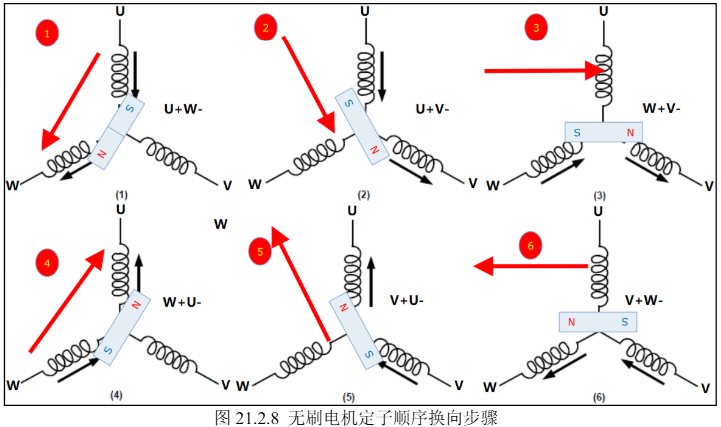
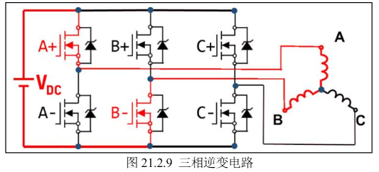

# 🏷️ 第21章 直流无刷电机

### 1. 什么是直流无刷电机（BLDC）

面试回答：

> BLDC 是一种没有电刷和换向器的直流电机，通过电子换向控制定子绕组电流方向，使产生旋转磁场，从而驱动永磁转子旋转。

核心区别：

|          | 有刷电机   | BLDC     |
| -------- | ---------- | -------- |
| 转子     | 线圈绕组   | 永磁体   |
| 定子     | 永磁体     | 三相绕组 |
| 换向方式 | 机械换向器 | 电子换向 |
| 寿命     | 短         | 长       |
| 控制     | 简单       | 复杂     |

---

### 2. BLDC 为什么需要换向？

这是面试高频。

因为：

- 定子线圈通电产生磁场
- 永磁转子受到磁力作用旋转
- 如果磁场固定，转子只能转到一个稳定位置
- 必须不断改变定子磁场方向，让转子持续追随

所以：

> BLDC 的本质就是不断改变三相绕组电流方向，产生旋转磁场。

---

### 3. BLDC 三相绕组结构

BLDC 通常：

- 三相绕组：
  - U相
  - V相
  - W相

一般采用：

> 星形连接

三个绕组一端内部连接，另外三端引出。

文档描述：

> 无刷电机绕组通常是3组，并且只有3个引出接线端子，一般为星形接法。  
> 

---

### 4. BLDC 与 PMSM 区别（重点）

这个非常容易被问。

文档核心：

|          | BLDC     | PMSM         |
| -------- | -------- | ------------ |
| 反电动势 | 梯形波   | 正弦波       |
| 电流     | 梯形波   | 正弦波       |
| 绕组     | 集中绕组 | 分布绕组     |
| 控制     | 六步换向 | FOC          |
| 导通方式 | 两两导通 | 三相同时导通 |

面试回答：

> BLDC 主要采用120°六步换向控制，电流接近梯形波；PMSM反电动势接近正弦波，因此通常采用FOC控制，使三相电流保持正弦。

---

### 5. BLDC 六步换向原理 

这是本章核心。

BLDC 有三相：

```
U
V
W
```

每次：

- 一相接正
- 一相接负
- 一相悬空

例如：

```
U+   V空   W-
```

电流：

```
U → W
```

产生磁场方向。

##### 换向对照切换表:

| 步骤 | U    | V    | W    |
| ---- | ---- | ---- | ---- |
| 1    | +    | 空   | -    |
| 2    | +    | -    | 空   |
| 3    | 空   | -    | +    |
| 4    | -    | 空   | +    |
| 5    | -    | +    | 空   |
| 6    | 空   | +    | -    |

循环后形成旋转磁场。

总结：

> BLDC 的运行方式为绕组两两导通，所以三相线圈的导通组合只有6种，根据合理顺序切换即可让转子跟着磁场旋转。  

---

##### 换向原理图:



### 6. 三相逆变桥 

这是连接 STM32 和 BLDC 的关键。

因为 MCU 输出：

```
GPIO/PWM
```

不能直接驱动电机。

所以需要：

```
STM32
 |
PWM
 |
三相逆变器
 |
UVW绕组
 |
BLDC
```

##### 三相逆变器：



三个：

- U桥
- V桥
- W桥

作用：

控制每一相：

- 接正极
- 接负极
- 高阻态

文档：

> 三相逆变电路就是由三个半桥构成，每个半桥控制对应的一相绕组。  

---

### 7. BLDC 为什么需要霍尔传感器？

因为换向需要知道转子位置。

霍尔作用：

检测：

- 转子位置
- 换向时刻

三路霍尔：

```
Hall_U
Hall_V
Hall_W
```

三个信号组合：

有6种有效状态。

对应六步换向。

文档：

> 霍尔传感器的3相电平输出主要用于指示无刷电机转子的位置。  

---

### 8. BLDC 调速原理 

不是直接改变电压，而是 PWM。

原因：

电机平均电压：

$$
U_{avg}=D\times U_{dc}
$$

改变占空比：

↓

改变绕组平均电压

↓

改变电流

↓

改变转矩

↓

改变速度

文档：

> 工作时一般使用PWM代替高低电平，控制线圈电流，从而控制转子扭矩及转速。  

---

### 9. BLDC 参数

⚫ **极对数：**转子磁铁 NS 级的对数，此参数和电机旋转速度有关：电子速度 = 电机实际速 度 * 极对数。

⚫ **KV 值：**电机的运转速度，值越大电机转速越大。电机转速 = KV 值 * 工作电压。同系 列同外形尺寸的无刷电机，根据绕线匝数的多少，会表现出不同的 KV 特性。绕线匝 数多的， KV 值低，最高输出电流小，扭力大；绕线匝数少的， KV 值高，最高输出 电流大，扭力小；

 ⚫ **额定转速：**额定的电流下的空载转速，通常单位用 RPM 表示； 

⚫ **转矩：**电机中转子产生的可以带动机械负载的驱动力矩。通常单位为：N.M；

# 🏷️ 第22章：有感方波驱动--新增面试知识点

这一章其实不是再教你一个全新的电机原理，而是把前面第21章学的：

> **BLDC + 霍尔位置检测 + 六步换相 + PWM**

真正落到 **STM32代码和硬件控制实现**上。

所以这一章最重要的是理解**“软件到底怎么根据霍尔状态控制六个MOS管”**。

---

### 一、最核心：霍尔状态 → 六步换相

这是本章最值得面试准备的知识点。

前面第21章你已经知道：

- BLDC 三相绕组：U、V、W
- 三个霍尔传感器：U、V、W
- 三个霍尔信号组合起来有 **6种有效状态**
- 每个状态对应一个固定的上下桥臂导通组合
- 霍尔状态变化 → 判断转子位置 → 切换MOS管 → 实现换相

例如文档中的正转表：

| 霍尔状态 | 导通   |
| -------- | ------ |
| 101      | U+、V- |
| 001      | U+、W- |
| 011      | V+、W- |
| 010      | V+、U- |
| 110      | W+、U- |
| 100      | W+、V- |

这张表你**非常值得记住逻辑，而不是死背表格**。

核心就是：

> **霍尔传感器负责“告诉我转子在哪”，六步换相表负责“告诉我现在应该开哪两个MOS”。**

文档明确说明，霍尔三个输出组合后可以判断当前转子具体位置，并且仍然满足六步一周期。

---

### 二、为什么是6种有效霍尔状态？

三个霍尔传感器，每个只有：

> 0 / 1

所以理论上有：

$$
2^3=8
$$

种组合。

但是 BLDC 六步换相中：

> **只有6种状态是有效的。**

剩下：

$$
000
$$

和

$$
111
$$

属于无效状态。

所以面试很容易问：

> **三个霍尔传感器为什么能确定六个换相区间？**

回答：

> 三个霍尔传感器形成3位二进制状态，理论上有8种组合，其中000和111为无效状态，因此剩下6种有效状态，每种状态对应一个电气区间和一组固定的上下桥臂导通关系。

这个回答已经比较像面试了。

---

### 三、为什么霍尔状态变化就要换相？

这个是面试官非常喜欢追问的“为什么”。

整个逻辑：

**转子转动**

↓

**霍尔状态变化**

↓

**检测到新的转子位置**

↓

**查六步换相表**

↓

**改变三相逆变桥MOS管导通组合**

↓

**产生新的定子磁场方向**

↓

**继续拉着永磁转子转动**

所以：

> **霍尔传感器本质上不是直接控制电机，而是在提供转子位置信息。**

真正负责输出功率的是：

> **三相逆变桥。**

这一点要和“霍尔控制电机”区分开。

---

### 四、三相逆变桥到底怎么控制BLDC？

前面你已经学过三相逆变桥，这一章开始真正把它用起来。

三相：

- U
- V
- W

每一相都有：

- 上桥臂
- 下桥臂

所以一共：

$$
3\times2=6
$$

个MOS管。

例如：

> U+ 导通，V- 导通，W相悬空

那么电流路径就是：

$$
V_{DC}\rightarrow U相绕组\rightarrow V相绕组\rightarrow GND
$$

于是：

- U相接正
- V相接负
- W相悬空

这就是六步换相中的一种状态。

---

### 五、为什么永远只有“两相导通，一相悬空”？

这是BLDC六步方波控制的核心特点。

例如：

> U+ + V-

那么：

- U：接正
- V：接负
- W：悬空

所以任意时刻：

> **两相导通，一相不导通。**

文档前面明确给出了这一运行方式：BLDC采用绕组两两导通的方式，因此三相线圈只有6种有效导通组合。

这也是为什么你后面学习**反电动势过零检测**时，会专门检测那一条“悬空相”。

---

### 六、PWM到底加在哪里？

这一章一个非常重要的工程知识就是：

**六步换相决定“方向”，PWM决定“力度”。**

可以把它理解成：

##### 换相

决定：

> 电流从哪一相流向哪一相。

##### PWM

决定：

> 这个电流到底有多大。

所以：

> **换相负责控制磁场方向，PWM负责控制电机的转矩/速度。**

文档中也明确说明，直接把电源加在线圈上会导致电机快速升速，因此实际工作时使用PWM代替高低电平，以控制线圈电流，从而控制转子扭矩和转速。

---

### 七、为什么PWM能够控制速度？

这个你面试时最好不要只回答：

> “因为PWM占空比改变了。”

最好继续说：

$$
D\uparrow
$$

↓

平均施加到绕组上的电压增大

↓

绕组电流能力增大

↓

产生的电磁转矩增大

↓

电机转速发生变化

所以更准确地说：

> **PWM通过改变绕组上的平均电压/电流，进而改变电磁转矩，使电机达到不同的转速。**

---

### 八、霍尔传感器代码实际上在干什么？

这一章代码里有一个非常典型的操作：

把三个霍尔GPIO读取结果组合成一个三位状态。

例如：

```c
State |= 0x01U;
State |= 0x02U;
State |= 0x04U;
```

最终得到：

$$
State = H_3H_2H_1
$$

也就是说：

- Hall1 → 最低位
- Hall2 → 中间位
- Hall3 → 最高位

文档明确说明了这一点。

因此面试如果问：

> **“你的BLDC代码怎么根据霍尔信号实现换相？”**

你可以直接说：

> 我先读取三个霍尔GPIO，将三个霍尔状态组合成一个3位状态值，然后根据这个状态查六步换相表，确定当前应该导通哪一个上桥臂和哪一个下桥臂，再通过PWM控制导通桥臂的占空比。

这句话非常适合背。

---

### 九、电机启动和停止为什么不能只关闭PWM？

这是本章代码里一个比较有价值的工程细节。

文档中的 `stop_motor1()` 做了多件事情：

1. 关闭驱动芯片输出
2. 停止三个PWM通道
3. 将三个CCR清零
4. 将低侧IO全部关闭
5. 最终让上下桥臂全部关断

而启动时则：

1. 使能驱动芯片
2. 开启TIM1三个PWM通道

文档明确展示了这个启停逻辑。

所以面试可以问：

> **“为什么电机停止时不只是把PWM占空比设置为0？”**

从这份代码的设计来看，更稳妥的回答是：

> 停止电机不仅要让PWM停止，还需要关闭驱动器输出并确保上下桥臂全部关断，从硬件层面保证功率器件处于安全状态。

---

### 十、这一章和第21章到底有什么区别？

这个你复习时一定要分清。

##### 第21章

主要解决：

> **BLDC为什么能转？**

学习：

- BLDC结构
- 霍尔传感器
- 六步换相原理
- 三相逆变桥
- PWM
- 霍尔状态与换相关系

##### 第22章

主要解决：

> **STM32到底怎么把这个东西跑起来？**

新增的是：

- GPIO读取霍尔
- 霍尔状态组合
- 六步换相函数
- PWM输出
- TIM1三个通道
- 上下桥臂控制
- 电机启停
- 换相代码实现

所以你现在可以把两章理解成：

> **第21章 = 理论**

> **第22章 = 工程实现**

---

### 十一、这章还有一个特别值得你掌握的“代码思想”

六步换相函数本质上就是：

```text
读取霍尔
   ↓
得到Hall状态
   ↓
switch(Hall状态)
   ↓
选择六种换相状态之一
   ↓
设置三个CCR
   ↓
设置三个低侧GPIO
   ↓
完成换相
```

也就是说，**BLDC六步控制并不是什么特别神秘的算法**。

它本质上就是：

> **状态机 + PWM。**

这是一个非常适合面试的说法。

---

### 十二、面试优先级

如果你现在时间有限，我建议第22章按这个优先级复习：

#####  必须掌握

**1. 霍尔状态 → 六步换相**

**2. 三相逆变桥6个MOS管怎么控制**

**3. 为什么两相导通、一相悬空**

**4. PWM和换相分别负责什么**

**5. 霍尔传感器在BLDC控制中的作用**

---

#####  建议掌握

**6. 3个霍尔为什么有6个有效状态**

**7. Hall GPIO如何组合成状态值**

**8. 六步换相代码的整体结构**

**9. 电机启动/停止时做了哪些操作**

---

#####  了解即可

**10. 具体某个GPIO对应哪个TIM通道**

**11. 每个CCR具体写多少**

**12. 驱动板具体IO连接**

这些属于**项目代码细节**，除非你面试时简历明确写了这个项目，否则没必要死背。

---

### 最后给你压缩成一句面试话术

如果面试官问：

> **“你是怎么实现有感BLDC六步控制的？”**

你可以这样答：

> **通过三个霍尔传感器获取转子位置，将三个霍尔信号组合成6种有效状态，根据霍尔状态查六步换相表，控制三相逆变桥对应的一个上桥臂和一个下桥臂导通，使定子产生不断变化的旋转磁场；同时在导通桥臂上施加PWM，通过调节PWM占空比控制绕组电流，从而实现BLDC的转速和转矩控制。**

这句话基本把**第21章 + 第22章最核心的面试知识串起来了**。

另外注意：你这个 `403_` 文件后面实际上还包含**第25章无感驱动、第26章双闭环PID**等内容，所以后面如果你继续按“第22章、第25章、第26章”往下复习，我可以继续严格按实际章节给你拆“**新增了什么，而不是把前面已经学过的东西重新算进去**”。


# 🏷️ 第23章《无刷电机电压温度电流采集》

### 一、三相电流采集原理（重点）

这是本章最重要的知识点。

##### 1. 为什么不能直接测电流？

STM32 ADC 只能采集**电压信号**，不能直接测电流。

所以需要：

> 电流 → 采样电阻 → 电压 → 放大 → ADC → 软件计算电流


面试回答：

> 电流采集本质是通过采样电阻把电流转换成电压，再经过运放放大后送入 ADC，最后根据比例关系计算实际电流。

---

##### 2. 采样电阻原理

驱动板在 U/V/W 三相电路中加入采样电阻。

例如 U 相：

采样电阻：

$$
R=20m\Omega=0.02\Omega
$$

根据欧姆定律：

$$
V=IR
$$

所以：

$$
I-V_U=I\times0.02
$$

例如：

10A：

$$
V=10\times0.02=0.2V
$$

20A：

$$
V=20\times0.02=0.4V
$$

但是这个电压太小，ADC 分辨率不足，所以需要放大。


---

##### 3. 差分放大电路

放大倍数：

$$
Gain=\frac{12K}{1K+1K}=6
$$

同时加入 1.25V 偏置：

最终 ADC 电压：

$$
AMP\_IU=6(0.02I)+1.25
$$

即：

$$
AMP\_IU=0.12I+1.25
$$

所以：

$$
I=\frac{AMP\_IU-1.25}{0.12}
$$


---

##### 面试可能问：

###### 为什么要加 1.25V 偏置？

因为电机电流有正负方向。

例如：

正电流：

ADC 电压 > 1.25V

负电流：

ADC 电压 < 1.25V

这样 ADC 单电源输入也可以表示双向电流。

---

### 二、电源电压采集（重点）

##### 1. 为什么需要分压？

驱动板电压可能：

12V~60V

但是 STM32 ADC：

0~3.3V

所以不能直接采样。

采用：

> 电阻分压 + 电压跟随器


---

##### 2. 分压公式

电阻：

12K + 12K + 1K

ADC输入：

$$
VBUS=
\frac{POWER}{12K+12K+1K}
\times1K
$$

即：

$$
VBUS=
\frac{POWER}{25}
$$

所以：

$$
POWER=25\times VBUS
$$


---

##### 面试回答：

> 电压采集采用电阻分压降低电压，再利用运放跟随器提高输入阻抗，避免 ADC 采样影响分压电路。

---

### 三、温度采集原理（重点）

##### 1. 使用什么传感器？

NTC 热敏电阻。

特点：

> 温度越高，电阻越低。


---

##### 2. 电路结构

NTC + 4.7K 电阻组成分压：

$$
VTEMP=
\frac{3.3\times4.7K}{Rt+4.7K}
$$

ADC 得到 VTEMP：

反推出：

$$
Rt
$$

然后通过 NTC 的 B 参数公式计算温度。


---

### 四、ADC + DMA 多通道采集（重点）

这一章把前面 ADC/DMA 知识应用到了电机。

新增：

采集：

| 参数     | ADC通道 |
| -------- | ------- |
| 电源电压 | PB1     |
| 温度     | PA0     |
| U相电流  | PB0     |
| V相电流  | PA6     |
| W相电流  | PA3     |


---

##### 为什么使用 DMA？

面试回答：

> 因为电机控制需要周期性采集多个模拟量，如果 CPU 一个一个读取 ADC 会占用大量时间，因此使用 DMA 自动搬运 ADC 数据，提高实时性。

---

### 五、ADC采样滤波（新增代码思想）

代码里面不是直接使用一次 ADC 值。

而是：

1. DMA连续采样
2. 累加多次
3. 求平均

例如：

$$
ADC_{avg}
=
\frac{\sum ADC}{N}
$$

作用：

- 降低噪声
- 提高稳定性

`173_PDFsam_DMF407电机控制专题教程_V1.0_第 5 章 直流有刷电机.pdf`

---

### 六、采集数据在闭环控制中的作用（面试重点）

这一章其实是在为后面的闭环铺路。

后续：

##### 速度闭环

需要：

速度反馈

来源：

霍尔测速

##### 电流环

需要：

电流反馈

来源：

本章三相电流采集

第24章速度+电流双闭环直接使用第23章采集的数据。

所以面试可以这样串起来：

> 无刷电机控制中，通过霍尔或者无感方式获得速度反馈，通过电流采样电路获得三相电流反馈，再利用 PID 构成速度环和电流环，实现闭环控制。

---

### 七、代码层面的新增知识点（面试可能问）

##### 1. 初始化流程

本章程序流程：

1. 初始化 BLDC 基础驱动
2. 初始化 ADC + DMA
3. 设置 PWM 控制速度
4. 在 PWM 中断中采集数据

`173_PDFsam_DMF407电机控制专题教程_V1.0_第 5 章 直流有刷电机.pdf`

---

##### 2. 为什么在PWM中断采集？

因为：

PWM频率固定

采样时刻同步：

- 减少干扰
- 保证采样周期稳定

`173_PDFsam_DMF407电机控制专题教程_V1.0_第 5 章 直流有刷电机.pdf`

---

### 第23章面试必背总结

如果面试官问：

##### Q：第23章主要学到了什么？

回答：

> 第23章主要学习无刷电机运行参数采集，包括三相电流、电源电压和温度采集。电流采集采用采样电阻将电流转换为电压，再经过差分放大后进入ADC；电压采集采用电阻分压和运放跟随；温度采用NTC分压采集。STM32通过ADC+DMA实现多通道高速采集，为后续速度闭环和电流闭环控制提供反馈。

---

##### 和前面章节串联后的知识体系

```
第21章
BLDC六步换向
        ↓
第22章
PWM控制三相逆变
        ↓
第23章
采集电压、电流、温度
        ↓
第24章
速度环 + 电流环闭环
        ↓
第25章
无感控制
```

所以第23章真正新增的核心只有一句：

> **学会建立电机控制系统的“反馈通道”。**

这章面试价值很高，因为它连接了“驱动”和“闭环控制”。我也可以继续帮你整理第24章新增的速度环、电流环面试知识点。


# 🏷️ 24.1 节“速度闭环控制”

### 源码中 BLDC 电机速度计算完整解析

代码文件：`bldc_tim.c` → `HAL_TIM_PeriodElapsedCallback`（TIM1 高级定时器更新中断，周期约 55us），配合`bldc.c`里面`uemf_edge()`边沿检测函数。

> 硬件前提：电机是**2 对极霍尔无刷电机**（4 个磁极：N‑S‑N‑S），宏定义：

```c
#define SPEED_COEFF      (uint32_t)((18000/4)*60)
```

`SPEED_COEFF = (18000 / 4) * 60 = 270000`。

### 1、关键变量

```c
g_bldc_motor1.count_j;     // 计数器，每进一次TIM1中断就+1，中断周期≈55us
g_bldc_motor1.hall_single_sta; // 只取霍尔U的电平(0/1)
g_bldc_motor1.hall_sta_edge;   // uemf_edge返回结果：0下降沿，1上升沿，2无变化
```

`uemf_edge(g_bldc_motor1.hall_single_sta)`：只跟踪**U 相霍尔单路信号**的跳变，不是全部 3 路霍尔组合状态，只看 U 霍尔高低电平翻转。

### 2、中断内计数逻辑（TIM1 每 55us 进一次）

```c
g_bldc_motor1.count_j++;   // 每次定时器中断+1，代表时间流逝
g_bldc_motor1.hall_sta_edge = uemf_edge(g_bldc_motor1.hall_single_sta);
```

`uemf_edge`逻辑：

- 检测 U 霍尔电平变化；
- 返回`0`：**下降沿（1→0）**；
- 返回`1`：**上升沿（0→1）**；
- 返回`2`：电平没有变化。

##### ① 捕获下降沿 `hall_sta_edge == 0`

> U 霍尔从高变低，代表完成**一次完整高电平脉冲**，此时`count_j`里面存的就是 U 霍尔高电平持续的定时器中断次数。

```c
if(g_bldc_motor1.hall_sta_edge == 0)
{
    if(g_bldc_motor1.dir == CW)
        temp_speed = (SPEED_COEFF / g_bldc_motor1.count_j);
    else
        temp_speed = -(SPEED_COEFF / g_bldc_motor1.count_j);

    FirstOrderRC_LPF(g_bldc_motor1.speed,temp_speed,0.2379f); //一阶RC低通滤波
    g_bldc_motor1.no_single = 0;
    g_bldc_motor1.count_j = 0; //计数器清零，重新计时下一个高电平
}
```

##### ②捕获上升沿 `hall_sta_edge ==1`

```c
if(g_bldc_motor1.hall_sta_edge == 1)
{
    g_bldc_motor1.no_single = 0;
    g_bldc_motor1.count_j = 0; //上升沿直接清计数器，不做速度计算
}
```

##### ③长时间没有边沿跳变 `hall_sta_edge == 2`

```c
if(g_bldc_motor1.hall_sta_edge == 2)
{
    g_bldc_motor1.no_single++;
    if(g_bldc_motor1.no_single > 15000)
    {
        g_bldc_motor1.no_single = 0;
        g_bldc_motor1.speed = 0; //太久霍尔不变，判定电机停止
    }
}
```

### 3、公式拆解 `temp_speed = SPEED_COEFF / count_j`

1. TIM1 中断周期：`T_int = 55us`；
2. `count_j` = U 霍尔高电平期间一共进入多少次定时器中断；
3. U 霍尔**高电平持续时间**：`T_high = count_j × 55 μs`；
4. 电机 2 对极：旋转一圈，U 霍尔会输出**1 次高电平 + 1 次低电平**，一圈总时间 `T_round = 2 × T_high`；
5. 转速单位：**转 / 分钟 (rpm)**

$$
$rpm = \frac{60}{T_{round}}=\frac{60}{2\times count_j \times 55\times10^{-6}} =\frac{60\times 10^6}{2\times 55 \times count_j} =\frac{545454}{count_j}$
$$

源码中`SPEED_COEFF = (18000/4)*60 = 270000`，是工程取整后的系数，不是严格理论值，是实际调参得到的标定系数。

> `temp_speed = SPEED_COEFF / count_j`

- `count_j`越大 → 高电平时间越长 → 转速越低；
- `count_j`越小 → 高电平时间越短 → 转速越高；
- 方向：顺时针正数，逆时针负数。

### 4、一阶 RC 滤波

```c
FirstOrderRC_LPF(g_bldc_motor1.speed,temp_speed,0.2379f);
//宏定义：#define FirstOrderRC_LPF(Yn_1,Xn,a) Yn_1 = (1‑a)*Yn_1 + a*Xn
```

$$
$speed_{new}= (1‑a)\times speed_{old}+ a\times temp\_speed$
$$

`a=0.2379`，对原始转速做低通滤波，抑制霍尔噪声带来的转速跳动。

### 5、超时保护

如果连续 15000 次 TIM1 中断都没有检测到 U 霍尔电平翻转，就直接把`g_bldc_motor1.speed = 0`，判定电机停转，防止电机堵转时 count_j 溢出。

### 6、误区：不是用 3 路霍尔组合状态算速度

很多 BLDC 用**三路霍尔组合状态跳变**来算转速；但这份代码**只拿 U 相单路霍尔电平边沿**计算速度。

> 三路霍尔组合状态只用来做**六步换向**；速度只看 U 霍尔单路高低电平时间。

### 7、完整数据流

1. TIM1 每 55us 中断到来 → `count_j++`；
2. 读取 U 霍尔引脚电平，调用`uemf_edge()`检测边沿；
3. 当检测 U 霍尔下降沿，用`SPEED_COEFF / count_j`算出瞬时转速；
4. 一阶 RC 滤波得到平滑`g_bldc_motor1.speed`；
5. 清零`count_j`，重新开始计时；
6. 把`g_bldc_motor1.speed`送入 PID 闭环，`increment_pid_ctrl(&g_speed_pid,g_bldc_motor1.speed)`输出 PWM 占空比。

### 补充：为什么系数 SPEED_COEFF = (18000/4)*60

- 18000：定时器中断的频率（1/55e-6 ≈18000Hz）；
- 4：磁极对数 2 对极，一圈 U 霍尔会有 2 次高电平 2 次低电平；
- 60：转换成 rpm（每分钟）。

> 注意：这个系数是工程标定值，如果你更换极对数不一样的电机，这个宏必须修改，否则转速读数不准。

##### 举个简单例子

假设`count_j = 100`，中断周期 55us，U 高电平时间 = 100×55us =5.5ms；
 一圈总时间 = 11ms；
 理论转速：`60 / 0.011 ≈5454rpm`；
 源码计算：`temp_speed = 270000 / 100 =2700`，和理论不一致，说明这个系数是**实际调试匹配硬件的标定系数，不是严格理论公式**。

# 🏷️ 第24.2节《速度&电流双闭环控制》

我读取了文档403中的 **第24.2节《速度&电流双闭环控制》**。这一节相比24.1速度闭环，新增的面试重点主要是**双闭环结构、电流环作用、控制流程以及工程实现方式**。

### 1. 为什么需要速度环 + 电流环双闭环？

24.1只有速度环：

```
目标速度
   ↓
速度PID
   ↓
PWM占空比
   ↓
电机
   ↓
测速反馈
```

速度环直接调PWM。

问题：

- 负载突然增加时：
  - 电机转速下降
  - 速度误差增大
  - PID提高PWM
  - 电流慢慢增加
  - 恢复速度

但是速度环响应较慢，因为中间经过：

PWM → 电压 → 电流 → 转矩 → 转速

加入电流环：

```
             速度反馈
                ↑
目标速度 → 速度PID → 目标电流
                         ↓
                    电流PID
                         ↓
                       PWM
                         ↓
                       电机
                         ↓
                    实际电流反馈
```

电流环直接控制转矩，因此响应更快。

------

### 2. 双闭环里面两个环分别控制什么？（高频面试）

##### 外环：速度环

作用：

> 控制电机转速，使实际速度跟随目标速度。

输入：

- 目标速度
- 实际速度

输出：

- 目标电流

也就是说：

**速度PID不是直接控制PWM，而是给电流环提供目标。**

------

##### 内环：电流环

作用：

> 控制电机电流，也就是控制输出转矩。

输入：

- 目标电流
- 实际电流

输出：

- PWM占空比

因为：

[
T=K_t I
]

电流越大，产生的电磁转矩越大。

所以文档中指出：

> 通过PID电流环初始化设置转矩大小，即电流大小，目标电流越大，转矩越大。

------

### 3. 为什么电流环放里面，速度环放外面？（面试重点）

原因：

##### 电流响应速度快

电流变化主要由：

- 电机电感
- PWM

决定。

时间常数小。

##### 速度响应慢

速度受到：

- 转动惯量
- 负载

影响。

所以控制结构：

```
快速变化量 → 内环
慢变化量 → 外环
```

类似：

```
速度环:
几十ms级

电流环:
几百us~几ms级
```

因此：

> 电流环负责快速控制转矩，速度环负责慢速调节目标转矩。

------

### 4. 负载变化时双闭环如何工作？（非常适合面试回答）

假设：

电机运行稳定：

```
目标速度=实际速度
目标电流=实际电流
```

突然：

负载增加。

过程：

##### 第一步

负载增加：

↓

电机转速下降

##### 第二步

速度环检测：

```
目标速度 > 实际速度
```

产生速度误差。

##### 第三步

速度PID增加输出：

```
目标电流增加
```

##### 第四步

电流环检测：

```
目标电流 > 实际电流
```

##### 第五步

电流PID增加PWM：

↓

绕组电流增加

↓

转矩增加

↓

克服负载

最终：

速度恢复。

------

### 5. 为什么电流环能提高抗扰能力？

因为负载扰动首先影响的是：

```
电流 → 转矩 → 速度
```

电流环直接检测电流变化。

例如：

负载突然增加：

没有电流环：

```
速度下降
↓
速度PID发现
↓
增加PWM
```

中间慢。

有电流环：

```
电流变化
↓
立即调整PWM
↓
转矩恢复
```

响应更快。

------

### 6. 24.2硬件新增点

相比24.1速度环：

新增：

##### ADC采集三相电流

文档说明：

> 三相电流采集已经在第23章学习过，本节直接进入代码实现。

使用ADC：

- PB0
  - U相电流
- PA6
  - V相电流
- PA3
  - W相电流

同时还有：

- 电压 PB1
- 温度 PA0


------

### 7. 程序实现流程（面试可以背）

文档给出的配置步骤：

##### ① 电机基本驱动

实现：

- 启停
- 六步换向组合

即：

```
霍尔位置
 ↓
六步换向
 ↓
PWM输出
```

##### ② 初始化ADC

配置：

- ADC通道
- DMA
- 工作方式

##### ③ PID闭环控制

增加：

- 速度PID
- 电流PID

包括：

- 参数初始化
- PID计算

##### ④ 上位机通信

用于显示：

- 目标速度
- 实际速度
- PID波形

##### ⑤ 中断服务函数

PWM中断中完成：

- 换向控制
- 堵转检测
- PID周期计算


------

### 8. 双闭环代码结构面试回答

如果面试问：

> 你的BLDC双闭环怎么实现？

可以这样回答：

```
首先通过霍尔传感器获取转子位置，
根据六步换向表控制三相逆变桥换相。

然后通过霍尔周期计算实际速度，
速度PID根据速度误差输出目标电流。

ADC采集三相电流，
电流PID根据电流误差调节PWM占空比，
最终控制电机转矩。

整个系统形成速度外环、电流内环双闭环。
```

------

### 9. 速度环和电流环PID参数调节顺序（面试）

工程中：

不能直接调双环。

顺序：

##### 第一步

先调电流环：

目标：

- 快
- 稳
- 无明显振荡

##### 第二步

再调速度环：

速度环要求：

- 响应快
- 超调小

原因：

速度环依赖电流环。

如果电流环没调好：

速度环输出没有意义。

------

### 10. 这一节新增的核心关键词

面试记忆：

| 知识点         | 关键词             |
| -------------- | ------------------ |
| 双闭环结构     | 速度外环、电流内环 |
| 速度环输出     | 目标电流           |
| 电流环输出     | PWM占空比          |
| 电流作用       | 控制转矩           |
| 电流与转矩关系 | T=KtI              |
| 抗负载扰动     | 电流环快速响应     |
| 新增硬件       | ADC采集三相电流    |
| 程序核心       | ADC+PID+PWM中断    |
| 控制顺序       | 先电流环，再速度环 |

------

这一节实际上是从**“能让BLDC转起来”升级到“工业电机控制思想”**，面试价值比24.1速度环更高，因为它已经接近伺服电机常见的控制架构。

# 🏷️ 第25章 直流无刷电机无感控制

### 1. 为什么需要无感控制（面试常问）

之前有感 BLDC：

- 霍尔传感器检测转子位置
- MCU 根据霍尔状态决定六步换相

但是霍尔存在缺点：

1. 恶劣环境可靠性下降（高温、高振动、潮湿等）
2. 增加电机引线，不方便安装
3. 霍尔安装精度影响控制性能
4. 增加成本，占用空间

所以出现无感控制：

> 不安装位置传感器，通过电机自身产生的信息估算转子位置。


面试回答：

> 无感 BLDC 主要通过检测反电动势获取转子位置信息，从而替代霍尔传感器完成换相控制。

---

### 2. 反电动势法原理 

这是本章核心。

##### 2.1 什么是反电动势

电机旋转时：

- 永磁转子切割定子绕组磁场
- 绕组产生感应电压

这个电压方向与供电电压相反，因此叫：

> 反电动势（Back EMF）

关系：

$$
E=K_e\omega
$$

也就是：

速度越高：

↓

反电动势越大。

---

##### 2.2 为什么反电动势可以检测位置？

BLDC六步换相时：

三相：

- 一相接正
- 一相接负
- 一相悬空

例如：

U+、W-导通：

V相悬空。

此时：

V相没有参与导电，但是它会产生反电动势。

通过检测：

> 悬空相反电动势过零点

可以判断转子位置。

---

### 3. 无感控制最大难点：低速无法启动 

这是面试重点。

因为：

$$
E=K_e\omega
$$

静止：

$$
\omega=0
$$

所以：

$$
E=0
$$

也就是说：

> 电机不转时，没有反电动势，无法通过反电动势判断转子位置。

因此：

无感BLDC不能像有感一样直接启动。

必须增加：

**三段式启动技术**


---

### 4. 三段式启动 

##### 第一阶段：转子预定位

目的：

确定转子初始位置。

方法：

给某一组绕组通电：

产生固定方向磁场：

↓

吸引永磁转子：

↓

固定到已知位置。

例如：

固定PWM：

固定时间：

让转子锁定。


面试：

> 无感启动首先需要预定位，因为启动瞬间没有反电动势，无法获取转子位置。

---

##### 第二阶段：外同步加速

因为还没有反电动势：

所以不能闭环。

MCU人为产生：

六步换相信号。

也就是：

按照固定频率：

U→V→W顺序切换。

让转子跟随旋转。

这个阶段叫：

> 外同步运行。

加速方法：

###### ① 恒频升压

换相频率不变：

增加PWM电压。

###### ② 恒压升频

电压不变：

提高换相频率。

###### ③ 升频升压

两个同时提高。


---

##### 第三阶段：运行状态切换

当速度达到一定程度：

反电动势出现：

↓

开始检测过零点：

↓

切换到正常无感六步换相。

难点：

切换速度选择。

太低：

- 反电动势弱
- 判断错误

太高：

- 转子跟不上
- 失步

面试：

> 无感BLDC启动最困难的是加速和闭环切换阶段。

---

### 6. 比较器模式采样过零信号

本章硬件新增：

不直接ADC采样反电动势，而使用：

> 比较器检测过零。

流程：

反电动势信号

↓

比较器

↓

数字过零信号

↓

STM32捕获

↓

延迟30°

↓

换相

优势：

- 硬件响应快
- 减少CPU计算

---

### 7. 无感控制程序流程（面试结合代码）

配置步骤：

##### ① 基础六步换相

先实现：

- 启停
- 六步组合
- PWM控制

##### ② 转子预定位

固定一个换相状态。

##### ③ 外同步加速

按照速度表切换六步。

##### ④ 过零检测

检测：

- 三相过零状态
- 滤除尖峰

##### ⑤ 延迟30°换相

代码核心：

```
检测过零
    ↓
记录时间
    ↓
等待30°
    ↓
执行下一步换相
```

文档程序说明：

采集过零信号后：

先滤波防止换向尖峰干扰；

根据组合值判断换相；

不是立即换相，需要延迟30°电角度。

---

### 8. 无感 vs 有感面试对比 

|          | 有感BLDC             | 无感BLDC       |
| -------- | -------------------- | -------------- |
| 位置来源 | 霍尔传感器           | 反电动势       |
| 启动     | 直接启动             | 需要三段式启动 |
| 低速性能 | 好                   | 差             |
| 成本     | 高                   | 低             |
| 可靠性   | 传感器容易受环境影响 | 结构简单       |
| 控制难度 | 简单                 | 复杂           |

---

##### 9. 第25章新增面试关键词总结

这一章你需要重点背：

##### 必背1：**为什么无感需要启动过程？**

> 静止和低速时反电动势太小，无法检测转子位置，因此需要预定位、外同步加速、运行切换三段式启动。

---

##### 必背2：**反电动势如何判断位置？**

> 检测悬空相反电动势过零点，根据过零点延迟30°电角度进行换相。

---

##### 必背3：**为什么过零后延迟30°？**

> 因为BLDC六步换相中，反电动势过零点超前换相点30°电角度。

---

##### 必背4：**无感启动为什么容易失败？**

> 启动阶段没有位置反馈，属于开环控制，需要合理设置预定位时间、加速曲线和切换速度，否则容易失步。

---

##### 必背5：**无感控制难点是什么？**

> 启动阶段和开环到闭环切换阶段。

---


# 🏷️ 

# 🏷️ 

